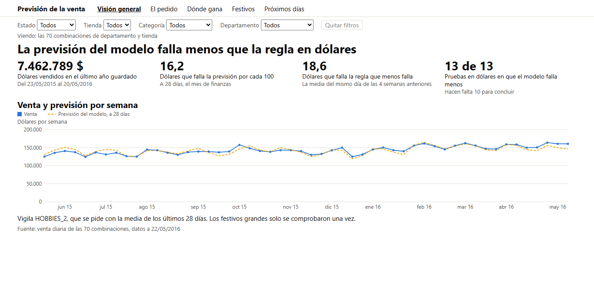

Versión en español: [README.md](README.md)

# Daily Walmart sales forecast by department and store

A model that forecasts daily sales for 70 Walmart department and store combinations (data from the M5 competition), over two horizons:
- **Ordering:** units, 10 days ahead.
- **Finance:** dollars, 28 days ahead.

[Final report](https://jleonceo.github.io/prevision-ventas-walmart-ml/informes/informe_final.html) · [Dashboard](https://jleonceo.github.io/prevision-ventas-walmart-ml/informes/cuadro_mando.html) (both in Spanish)

[](https://github.com/jleonceo/prevision-ventas-walmart-ml/actions/workflows/ci.yml)

## Results on the last year held back (hold-out: 23/05/2015 to 22/05/2016)

Error: how much the forecast misses per 100 sold (WAPE). The benchmark is the one of three simple rules that misses least: the average of the same weekday over the previous 4 weeks.

| Horizon | Model | Simple rule that misses least | Tests in which the model misses less |
|---|---|---|---|
| Units, 10 days ahead | **14.5** | 16.9 | 12 of 13 |
| Dollars, 28 days ahead | **16.2** | 18.6 | 13 of 13 |

Each test forecasts from a starting day (rolling origin); there is one every 28 days throughout the year.

These figures come from the model in use, retrained with data up to 22/05/2015. The model measured first, fitted only with data up to 22/05/2014, misses 15.3 in units and 17.5 in dollars. It wins 9 of the 13 unit tests and 12 of the dollar tests. The rule set before the test required at least 10: in units it falls one short and in dollars it passes.



*Weekly sales and forecast, in dollars, over the last year held back. First tab of the dashboard, no filters applied.*

### By department

The error for the whole year is driven by the departments that sell most: FOODS_3 accounts for almost half of the units. That is why it is also shown department by department. The model misses less than the rule in all seven.

| Department | Share of units | Units: model | Units: rule | Dollars: model | Dollars: rule |
|---|---|---|---|---|---|
| FOODS_1 | 9.6% | **20.5** | 21.7 | **21.6** | 24.3 |
| FOODS_2 | 12.7% | **17.6** | 23.4 | **16.9** | 22.6 |
| FOODS_3 | 46.0% | **10.9** | 13.5 | **13.2** | 15.1 |
| HOBBIES_1 | 9.1% | **20.8** | 22.1 | **19.2** | 21.1 |
| HOBBIES_2 | 0.9% | **50.2** | 54.5 | **60.5** | 63.9 |
| HOUSEHOLD_1 | 17.4% | **12.1** | 13.0 | **14.5** | 15.9 |
| HOUSEHOLD_2 | 4.3% | **20.2** | 21.1 | **22.3** | 24.1 |

**The exception:** in the HOBBIES_2 hobbies department, where sales are intermittent, another of the three rules, the average of the last 28 days, misses slightly less than the model: 50.1 in units and 59.8 in dollars. That department is ordered with it.

## Scope and limitations
- **Sample:** 500 of the competition's 3,049 products, chosen at random.
- **Validation:** the last year was held back until the end. The model in use was chosen after seeing that year. There is no other year of sales to confirm the choice.
- **Money:** savings cannot be calculated without cost, margin or stock data.

## Tools
- **Data:** [M5 Forecasting - Accuracy](https://www.kaggle.com/competitions/m5-forecasting-accuracy) (Kaggle), subject to the competition rules.
- **Modeling:** Python, scikit-learn (HistGradientBoosting) and statsmodels for exponential smoothing.
- **Outputs:** the final report and the dashboard are plain HTML with no external libraries, served with GitHub Pages.

## How to run it

You need conda and the environment in `environment.yml`:

```bash
git clone https://github.com/jleonceo/prevision-ventas-walmart-ml.git && cd prevision-ventas-walmart-ml
conda env create -f environment.yml && conda activate 69_prevision_ventas_walmart
python -W error tests/probar_18_informe_final.py
```

The last command runs the final report's test. It does not need the data: it reads the reports included in the repository. Without the data, all 32 tests in `tests/` pass, and so does the one in `datos_origen/`. Two of them, the dashboard tests in the browser, open Microsoft Edge and are not part of the CI.

## The data

The data are not included in this repository. They come from Kaggle's [M5 Forecasting - Accuracy](https://www.kaggle.com/competitions/m5-forecasting-accuracy) competition: daily sales of 3,049 Walmart products in 10 stores across three states, from 29/01/2011 to 22/05/2016, with weekly prices and a calendar of holidays and food assistance (SNAP) payment days. Kaggle publishes them subject to the competition rules, which do not allow redistribution: that is why they are not here. These are product and store records: no column refers to a person.

How they were prepared:

1. **Download:** the competition's three files, `sales_train_evaluation.csv`, `sell_prices.csv` and `calendar.csv`, from the Data tab with an account that has accepted its rules.
2. **Sample:** `datos_origen/recortar_m5.py` picks 500 products at random with seed 69, in all 10 stores. Sales are then summed by department and store: 7 departments times 10 stores give the 70 series.
3. **The year held back:** `datos_origen/apartar_prueba_final.py` leaves in `data/raw/` the sales up to 22/05/2015 and the prices up to the week ending that day. Sales and prices from 23/05/2015 to 22/05/2016 are kept apart, in `data/raw/reserva/`, until the final test. The calendar is kept whole. Part of that year was looked at in an initial exploration, before it was set aside.

```bash
python datos_origen/recortar_m5.py <folder_with_the_m5_csvs> recorte
mkdir -p data/raw && cp recorte/calendar.csv data/raw/
python datos_origen/apartar_prueba_final.py recorte data/raw data/raw/reserva
```

When the sample was made, its 5,000 series were checked row by row against the original. The hold-out split has been run again and gives the same files, byte for byte. To check that your sample matches the case's without having its data, `datos_origen/SHA256SUMS` stores the fingerprint of each file:

```bash
sha256sum -c datos_origen/SHA256SUMS
```

With the data in place, the scripts in `scripts/` run in order, from `01` to `21`, as each script's header describes. The final test (`20`) first runs the batch in `produccion/lote_prueba_final.py` with the model in use. Two scripts need something that is not in the repository:
- script `08` builds the executive report as a PDF with Microsoft Edge;
- script `09` fills in an Excel template that is not included.

## Repository layout

- `scripts/`: the chain of 21 scripts, numbered in process order, from the raw data to the final report and the dashboard, plus the four forecasting modules shared by modeling and production.
- `datos_origen/`: the sampling of the competition data and the hold-out split, with the split's test and the fingerprints of the files they produce.
- `tests/`: one test suite per script, each including cases that must fail.
- `produccion/`: retraining, the daily forecast, the daily batch with its dry run, the final-test batch and the rollback to a previous model.
- `modelos/reentrenos/2015-05-22/`: the model in use, one for units and one for dollars, each with its metadata.
- `informes/`: the final report, the dashboard and the report from each step.
- `config/`: the business rules, the transformation rules, the data model design and the production contract.
- `assets/`: the shared pieces for charts and reports.
- `docs/graficos/`: the dashboard screenshot used in this README.

## Related repositories

- [store-sales-forecasting-ml](https://github.com/jleonceo/store-sales-forecasting-ml): daily sales forecasting by store and product, with time-based validation and simulated batch deployment.
- [reposicion-inventario-prevision-ml](https://github.com/jleonceo/reposicion-inventario-prevision-ml): a daily replenishment decision backed by a demand forecast, measured on a half-year held back for the final test.
- [averias-discos-duros-ml](https://github.com/jleonceo/averias-discos-duros-ml): hard drive failure prediction, with the same chain of scripts, reports and production.
