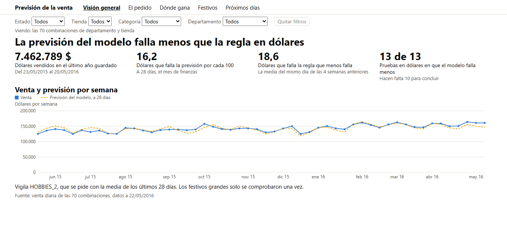

English version: [README.en.md](README.en.md)

# Previsión de la venta diaria de Walmart por departamento y tienda

Modelo de previsión de la venta diaria de 70 combinaciones de departamento y tienda de Walmart (datos del concurso M5), con dos horizontes:
- **Pedido:** unidades a 10 días.
- **Finanzas:** dólares a 28 días.

[Informe final](https://jleonceo.github.io/prevision-ventas-walmart-ml/informes/informe_final.html) · [Cuadro de mando](https://jleonceo.github.io/prevision-ventas-walmart-ml/informes/cuadro_mando.html)

[](https://github.com/jleonceo/prevision-ventas-walmart-ml/actions/workflows/ci.yml)

## Resultados en el último año guardado (hold-out: del 23/05/2015 al 22/05/2016)

Error: lo que falla la previsión por cada 100 vendidos (WAPE). La regla de comparación es la que menos falla de tres reglas sencillas: la media del mismo día de las 4 semanas anteriores.

| Horizonte | Modelo | La regla que menos falla | Pruebas en que el modelo falla menos |
|---|---|---|---|
| Unidades, a 10 días | **14,5** | 16,9 | 12 de 13 |
| Dólares, a 28 días | **16,2** | 18,6 | 13 de 13 |

Cada prueba prevé desde un día de partida (rolling origin); hay uno cada 28 días a lo largo del año.

Las cifras son del modelo en uso, reentrenado con los datos hasta el 22/05/2015. El que se midió primero, ajustado solo con los datos hasta el 22/05/2014, falla 15,3 en unidades y 17,5 en dólares. Ese gana en 9 de las 13 pruebas de unidades y en 12 de las de dólares. La regla fijada antes de la prueba pedía al menos 10: en unidades se queda a una del listón y en dólares pasa.



*La venta y la previsión por semana, en dólares, del último año guardado. Primera pestaña del cuadro de mando, sin filtros.*

### Por departamento

El error de todo el año lo marcan los departamentos que más venden: FOODS_3 hace casi la mitad de las unidades. Por eso va también departamento a departamento. El modelo falla menos que la regla en los siete.

| Departamento | Parte de las unidades | Unidades: modelo | Unidades: regla | Dólares: modelo | Dólares: regla |
|---|---|---|---|---|---|
| FOODS_1 | 9,6 % | **20,5** | 21,7 | **21,6** | 24,3 |
| FOODS_2 | 12,7 % | **17,6** | 23,4 | **16,9** | 22,6 |
| FOODS_3 | 46,0 % | **10,9** | 13,5 | **13,2** | 15,1 |
| HOBBIES_1 | 9,1 % | **20,8** | 22,1 | **19,2** | 21,1 |
| HOBBIES_2 | 0,9 % | **50,2** | 54,5 | **60,5** | 63,9 |
| HOUSEHOLD_1 | 17,4 % | **12,1** | 13,0 | **14,5** | 15,9 |
| HOUSEHOLD_2 | 4,3 % | **20,2** | 21,1 | **22,3** | 24,1 |

**La excepción:** en el departamento de ocio HOBBIES_2, de venta intermitente, otra de las tres reglas, la media de los últimos 28 días, falla un poco menos que el modelo: 50,1 en unidades y 59,8 en dólares. Ese departamento se pide con ella.

## Alcance y límites
- **Muestra:** 500 de los 3.049 productos del concurso, elegidos al azar.
- **Validación:** el último año quedó apartado hasta el final. El modelo en uso se eligió después de ver ese año. No hay otro año con venta para confirmar la elección.
- **Dinero:** el ahorro no se puede calcular sin coste, margen ni existencias.

## Herramientas
- **Datos:** [M5 Forecasting - Accuracy](https://www.kaggle.com/competitions/m5-forecasting-accuracy) (Kaggle), sujeto a las reglas del concurso.
- **Modelado:** Python, scikit-learn (HistGradientBoosting) y statsmodels para el suavizado exponencial.
- **Salidas:** el informe final y el cuadro de mando en HTML propio, sin librerías externas, servidos con GitHub Pages.

## Cómo se ejecuta

Hace falta conda y el entorno de `environment.yml`:

```bash
git clone https://github.com/jleonceo/prevision-ventas-walmart-ml.git && cd prevision-ventas-walmart-ml
conda env create -f environment.yml && conda activate 69_prevision_ventas_walmart
python -W error tests/probar_18_informe_final.py
```

El último comando pasa la prueba del informe final. No necesita los datos: lee los informes que trae el repositorio. Sin datos pasan las 32 pruebas de `tests/` y la de `datos_origen/`. Dos de ellas, las del cuadro de mando en el navegador, abren Microsoft Edge y no van en la CI.

## Los datos

Los datos no están en el repositorio. Son los del concurso [M5 Forecasting - Accuracy](https://www.kaggle.com/competitions/m5-forecasting-accuracy) de Kaggle: la venta diaria de 3.049 productos de Walmart en 10 tiendas de tres estados, del 29/01/2011 al 22/05/2016, con sus precios por semana y un calendario de festivos y días de cobro de la ayuda alimentaria (SNAP). Kaggle los publica sujetos a las reglas del concurso, que no dejan redistribuirlos: por eso no van aquí. Son datos de productos y tiendas: ninguna columna habla de una persona.

Cómo se prepararon:

1. **La descarga:** los tres ficheros del concurso, `sales_train_evaluation.csv`, `sell_prices.csv` y `calendar.csv`, desde la pestaña Data con una cuenta que haya aceptado sus reglas.
2. **El recorte:** `datos_origen/recortar_m5.py` elige 500 productos al azar con la semilla 69, en las 10 tiendas. La venta se suma después por departamento y tienda: 7 departamentos por 10 tiendas dan las 70 series.
3. **El año guardado:** `datos_origen/apartar_prueba_final.py` deja en `data/raw/` la venta hasta el 22/05/2015 y los precios hasta la semana que acaba ese día. La venta y los precios del 23/05/2015 al 22/05/2016 van aparte, en `data/raw/reserva/`, hasta la prueba final. El calendario va entero. Parte de ese año se miró en una exploración inicial, antes de apartarlo.

```bash
python datos_origen/recortar_m5.py <carpeta_con_los_csv_de_m5> recorte
mkdir -p data/raw && cp recorte/calendar.csv data/raw/
python datos_origen/apartar_prueba_final.py recorte data/raw data/raw/reserva
```

Al hacer el recorte se comprobó, fila a fila, que sus 5.000 series eran idénticas a las del original. El corte del año guardado se ha vuelto a ejecutar y da los mismos ficheros, byte a byte. Para comprobar que tu recorte sale igual que el del caso, sin tener sus datos, `datos_origen/SHA256SUMS` guarda la huella de cada fichero:

```bash
sha256sum -c datos_origen/SHA256SUMS
```

Con los datos en su sitio, los scripts de `scripts/` se lanzan en su orden, del `01` al `21`, como dice la cabecera de cada uno. La prueba final (`20`) lanza antes el lote de `produccion/lote_prueba_final.py` con el modelo en uso. Dos scripts piden algo que no está en el repositorio:
- el `08` hace el informe ejecutivo en PDF con Microsoft Edge;
- el `09` rellena una plantilla de Excel que no se incluye.

## Estructura del repositorio

- `scripts/`: la cadena de 21 scripts numerados en el orden del proceso, de los datos en bruto al informe final y el cuadro de mando, más los cuatro módulos de la previsión que comparten el modelado y la producción.
- `datos_origen/`: el recorte de los datos del concurso y el corte del año guardado, con la prueba del corte y las huellas de los ficheros que salen.
- `tests/`: un banco de pruebas por script, cada uno con casos que tienen que fallar.
- `produccion/`: el reentreno, la previsión diaria, el lote de cada día con su ensayo, el lote de la prueba final y la vuelta a un modelo anterior.
- `modelos/reentrenos/2015-05-22/`: el modelo en uso, uno para unidades y otro para dólares, cada uno con su ficha.
- `informes/`: el informe final, el cuadro de mando y los informes de cada paso.
- `config/`: las reglas de negocio, las de transformación, el diseño del modelo de datos y el contrato de producción.
- `assets/`: las piezas comunes de los gráficos y de los informes.
- `docs/graficos/`: la captura del cuadro de mando de este README.

## Repositorios relacionados

- [store-sales-forecasting-ml](https://github.com/jleonceo/store-sales-forecasting-ml): previsión diaria de ventas por tienda y producto, con validación temporal y despliegue por lotes simulado.
- [reposicion-inventario-prevision-ml](https://github.com/jleonceo/reposicion-inventario-prevision-ml): una decisión diaria de reposición apoyada en una previsión de demanda, medida en un semestre reservado para la prueba final.
- [averias-discos-duros-ml](https://github.com/jleonceo/averias-discos-duros-ml): predicción de fallos de discos duros, con la misma cadena de scripts, informes y producción.
