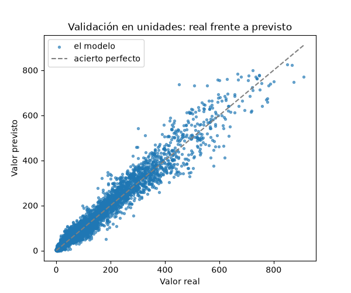
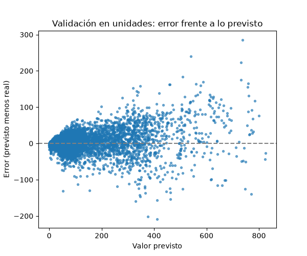
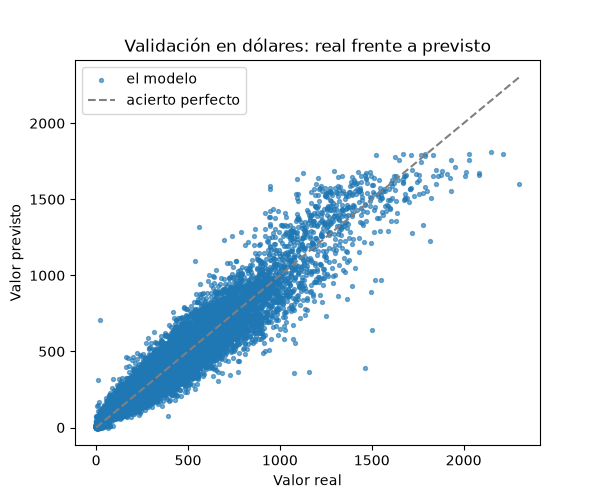
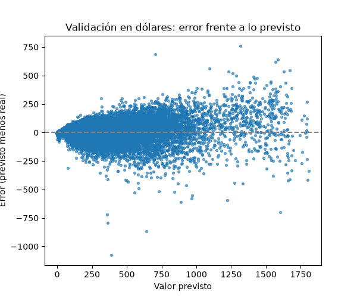

# El modelado · caso 69

Fecha de los datos: 22/05/2015. Informe interno de auditoría del modelo, generado de `informes/modelado.json` por `scripts/17_informe_modelado.py`. Estado: OK. No mide nada nuevo: cita lo que dejaron los pasos del modelado.

**El modelo gana a las tres reglas en los dos objetivos y se da por bueno.** En unidades falla 15,64 frente a 17,93 de la regla que menos falla. En dólares falla 17,37 frente a 19,44 de la regla que menos falla. Veredicto aprobado: el responsable del caso, 25/11/2026, «Sí, apruebo el veredicto».

## Lo aprobado antes de entrenar

Todo lo de este apartado se aprobó antes de entrenar; este informe no lo cambia.

- **Hace falta modelar: sí.** La ficha pide una previsión diaria de cada departamento en cada tienda; el exploratorio no la contesta.
- **Decide sobre personas: no.** La previsión informa y decide una persona; no decide sobre personas (ficha, «Las seis comprobaciones»).
- **Medida principal:** error de la previsión: unidades (o dólares) que falla por cada 100 vendidas, de las 70 series juntas y todos los días del periodo, sin el 25 de diciembre, con el sesgo al lado. Por qué: reglas, apartado 6: el error de las 70 juntas decide; el sesgo, porque el error puede bajar mientras la previsión se queda corta.
- **Referencias:** las tres reglas sencillas (reglas, apartado 7); el trivial, DummyRegressor con la mediana (método, apartado 6); el suavizado exponencial (planteamientos §1), que se mide con la validación.
- **Lo que se da por bueno:** reglas, apartado 7, «Qué cuenta como mejora»: menos error que la regla que menos falla en al menos el 75 % de los orígenes y el intervalo del 95 % de la ventaja por encima de cero; se decide en la validación.
- **Algoritmos y búsqueda:** HistGradientBoosting y Ridge; nivel equilibrado; 15 candidatos al azar en HistGradientBoosting y la rejilla entera de Ridge; 5 cortes por fecha; medida en recursivo; los 25 de diciembre entran en el ajuste y salen de la medida. Lo aprobó el responsable del caso, 24/11/2026, «Sí, tal cual».
- **El ganador, aprobado antes de abrir la validación:** El responsable del caso, 25/11/2026, «Apruebo el ganador».
- **Partición por fecha:** entrenamiento con 84.700 filas, del 29/01/2011 al 22/05/2014 (1.210 días); validación con 25.550 filas, del 23/05/2014 al 22/05/2015 (365 días).
- **Historia que piden las variables:** salen del entrenamiento 2.450 filas, del 29/01/2011 al 04/03/2011; quedan 82.250 para ajustar.
- **Preselección:** modo comparativo, escenario consenso amplio; fijado en negocio/reglas-negocio.md §7, «Preselección de variables» (el responsable del caso, 24/11/2026).

## Qué se probó y cuánto costó

Primero un modelo mínimo, sin búsqueda, para ver dónde estaba el listón. Después, la búsqueda aprobada.

- **Modelo mínimo en unidades:** falla 16,18 en recursivo y 14,31 a un día.
- **Modelo mínimo en dólares:** falla 17,52 en recursivo y 15,60 a un día.

La validación cruzada: «TimeSeriesSplit sobre los días, sin barajar, ventana creciente; los cortes del modelo mínimo». Fueron 5 cortes. Cada corte prevé 10 días en unidades y 28 en dólares, desde estos orígenes:

- unidades: 02/04/2014, 12/04/2014, 22/04/2014, 02/05/2014, 12/05/2014.
- dólares: 02/01/2014, 30/01/2014, 27/02/2014, 27/03/2014, 24/04/2014.

La búsqueda fue de nivel equilibrado. Su medida: error de reglas, apartado 6 en recursivo desde el origen de cada corte; gana la menor media. Qué parte del espacio se probó:

| Objetivo | Algoritmo | Tipo | Combinaciones probadas | Combinaciones posibles |
|---|---|---|---:|---:|
| unidades | HistGradientBoosting | aleatoria | 15 | 72 |
| unidades | Ridge | rejilla | 13 | 13 |
| dólares | HistGradientBoosting | aleatoria | 15 | 72 |
| dólares | Ridge | rejilla | 13 | 13 |

La búsqueda ajustó 355 modelos (unidades/HistGradientBoosting: 110; unidades/Ridge: 65; dolares/HistGradientBoosting: 110; dolares/Ridge: 70), más los de control (reajuste_del_ganador: 2; regla_simple: 10; canario: 4; reproducible: 2). Tardó 2.080 segundos; la validación, 186.

Se ampliaron las rejillas 19 veces por un borde o un rango plano; 15 de esas ampliaciones se midieron y las demás no eran posibles. Las segundas búsquedas que contestaban esas ampliaciones fueron estas:

| Objetivo | Algoritmo | Mejora media | Desviación | Se sostiene |
|---|---|---:|---:|---|
| unidades | HistGradientBoosting | -0,06 | 0,32 | no |
| dólares | HistGradientBoosting | +0,10 | 0,42 | no |
| dólares | Ridge | +0,00 | 0,07 | no |

## El desequilibrio

No aplica a esta previsión. El desequilibrio del método es el de un objetivo de sí o no con una clase mucho más rara que la otra; aquí los dos objetivos son cantidades.

- Motivo que dejó la búsqueda: «no aplica: los dos objetivos son cantidades».
- Lo que dice la partición: «objetivo continuo: no hay tasa ni desequilibrio de clases».
- Por eso no se equilibró nada ni hubo que recalibrar: «no aplica: sin equilibrar».

## Ranking

El error es el de los cortes de la validación cruzada, previendo en recursivo; el de entrenamiento se mide a un día en las filas del ajuste. La distancia entre los dos es el sobreajuste.

### Unidades, a 10 días

| Algoritmo | Error medio | Desviación entre cortes | Sesgo | Error en entrenamiento | Cortes que gana, de 5 |
|---|---:|---:|---:|---:|---:|
| HistGradientBoosting | 15,64 | 0,74 | +0,66 | 13,65 | 4 |
| Ridge | 21,06 | 1,36 | -1,97 | 20,70 | 0 |

| Referencia | Error medio | Sesgo |
|---|---:|---:|
| el trivial (la mediana) | 73,69 | -45,66 |
| repetir la semana anterior | 22,53 | -0,46 |
| la media de los últimos 28 días | 21,00 | +0,03 |
| la media del mismo día de las 4 semanas anteriores | 17,96 | -0,36 |

Pliegue a pliegue, HistGradientBoosting menos Ridge da -5,42 puntos de media, con una desviación de 1,26. Empate: no.

### Dólares, a 28 días

| Algoritmo | Error medio | Desviación entre cortes | Sesgo | Error en entrenamiento | Cortes que gana, de 5 |
|---|---:|---:|---:|---:|---:|
| HistGradientBoosting | 17,37 | 0,87 | +2,99 | 14,08 | 5 |
| Ridge | 23,23 | 1,42 | -5,59 | 20,67 | 1 |

| Referencia | Error medio | Sesgo |
|---|---:|---:|
| el trivial (la mediana) | 69,50 | -40,97 |
| repetir la semana anterior | 23,85 | -6,91 |
| la media de los últimos 28 días | 22,93 | -1,04 |
| la media del mismo día de las 4 semanas anteriores | 19,59 | -1,04 |

Pliegue a pliegue, HistGradientBoosting menos Ridge da -5,85 puntos de media, con una desviación de 1,54. Empate: no.

## El ganador y por qué

### Unidades, a 10 días

Gana HistGradientBoosting, con 82 columnas y semilla 42. Se reajustó con 82.250 filas de la construcción. Por qué: gana pliegue a pliegue: la media de las diferencias pasa de su desviación. Su ficha está en `assets/fichas_de_algoritmos/histgradientboosting/01_ficha.md`.

- **Hiperparámetros elegidos:** `min_samples_leaf` = 205; `max_iter` = 500; `max_depth` = sin límite; `learning_rate` = 0,1; `l2_regularization` = 0.
- **Frente a la regla simple:** con solo las dos variables que más pesan (`unidades_media_7`, `unidades_lag_1`), una regresión lineal falla 21,83. El ganador la supera pliegue a pliegue: sí (diferencia media de -6,19, desviación de 1,48).
- **Canario:** con el objetivo barajado falla 80,95; con la venta real puesta como variable, 0,90. Un error por debajo de 5 apuntaría a que la previsión usa el futuro: la comprobación ve una fuga cuando la hay.

### Dólares, a 28 días

Gana HistGradientBoosting, con 82 columnas y semilla 42. Se reajustó con 82.250 filas de la construcción. Por qué: gana pliegue a pliegue: la media de las diferencias pasa de su desviación. Su ficha está en `assets/fichas_de_algoritmos/histgradientboosting/01_ficha.md`.

- **Hiperparámetros elegidos:** `min_samples_leaf` = 205; `max_iter` = 500; `max_depth` = sin límite; `learning_rate` = 0,1; `l2_regularization` = 0.
- **Frente a la regla simple:** con solo las dos variables que más pesan (`dolares_media_7`, `dolares_lag_1`), una regresión lineal falla 25,33. El ganador la supera pliegue a pliegue: sí (diferencia media de -7,96, desviación de 2,49).
- **Canario:** con el objetivo barajado falla 70,45; con la venta real puesta como variable, 1,56. Un error por debajo de 5 apuntaría a que la previsión usa el futuro: la comprobación ve una fuga cuando la hay.

## Qué variables pesan

La importancia es lo que empeora el error al barajar cada variable de origen. Dice que el modelo usa esa variable para acertar. No dice que cause la venta.

### Unidades, a 10 días

| Variable | Importancia | Desviación |
|---|---:|---:|
| `unidades_media_7` | 28,84 | 1,88 |
| `unidades_lag_1` | 13,87 | 1,91 |
| `unidades_media_28` | 6,45 | 1,29 |
| `weekday` | 3,15 | 0,71 |
| `unidades_lag_7` | 2,53 | 1,33 |

Son las primeras de 50 variables de origen. Las dos primeras llevan 0,66 de la importancia positiva, en tanto por uno. Método: permutacion por variable de origen; filas: fuera de pliegue: 3500 filas de prueba de los 5 cortes, a un día con los retardos reales; puntuación: menos el error de reglas, apartado 6, con la previsión acotada y redondeada.

### Dólares, a 28 días

| Variable | Importancia | Desviación |
|---|---:|---:|
| `dolares_media_7` | 21,80 | 1,06 |
| `dolares_lag_1` | 8,56 | 0,39 |
| `dolares_media_28` | 5,90 | 0,52 |
| `dolares_lag_7` | 4,00 | 0,48 |
| `weekday` | 3,84 | 0,61 |

Son las primeras de 50 variables de origen. Las dos primeras llevan 0,56 de la importancia positiva, en tanto por uno. Método: permutacion por variable de origen; filas: fuera de pliegue: 9800 filas de prueba de los 5 cortes, a un día con los retardos reales; puntuación: menos el error de reglas, apartado 6, con la previsión acotada.

## La validación

El ganador se midió una sola vez en la validación, en recursivo y con las 70 series enteras (muestra: no). Cómo van las previsiones: «acotados en cero y, en unidades, redondeados: como se miden».

### Unidades, a 10 días: gana

Se midió desde 13 orígenes, del 23/05/2014 al 03/05/2015, con 9.100 filas. Cada serie tiene 130 días previstos.

**El veredicto y sus dos condiciones** (reglas, apartado 7, «Qué cuenta como mejora»):

- Falla menos que la regla que menos falla en 12 de 13 orígenes; hacían falta 10. Se cumple: sí.
- La ventaja es de +2,28 puntos (ventaja en puntos de error por cada 100), con un intervalo de +1,23 a +3,49. Entero por encima de cero: sí.
- El intervalo sale de remuestrear 1.000 veces las combinaciones de departamento y tienda enteras, con todos sus días y orígenes, 70 series, con semilla 42.

**El error y el sesgo**, en unidades por cada 100 vendidas. Filas: «validacion: 9100 filas de 13 orígenes». El trivial es la mediana de las filas del ajuste, como en scripts/15_busqueda.py.

| Previsión | Error | Sesgo |
|---|---:|---:|
| el modelo | 15,64 | +3,25 |
| repetir la semana anterior | 22,20 | -1,64 |
| la media de los últimos 28 días | 21,64 | -3,58 |
| la media del mismo día de las 4 semanas anteriores | 17,93 | +0,28 |
| el trivial (la mediana) | 72,51 | -45,94 |
| el suavizado exponencial | 17,40 | -0,93 |

**El suavizado exponencial, como lectura.** El modelo falla menos que él en 10 de 13 orígenes. La diferencia es de +1,75 puntos, con un intervalo de +0,51 a +3,28. Lectura: gana. El veredicto se mide solo frente a las tres reglas.

**La recomendación de cada departamento.** Se recomienda el modelo en 6 de 7 departamentos. Donde el modelo falla de media más que la regla que menos falla, se recomienda esa regla; el veredicto principal no cambia.

| Departamento | Error del modelo | Regla que menos falla | Error de la regla | Se recomienda |
|---|---:|---|---:|---|
| FOODS_1 | 20,33 | la media del mismo día de las 4 semanas anteriores | 23,07 | el modelo |
| FOODS_2 | 18,47 | la media del mismo día de las 4 semanas anteriores | 24,64 | el modelo |
| FOODS_3 | 12,53 | la media del mismo día de las 4 semanas anteriores | 14,71 | el modelo |
| HOBBIES_1 | 22,21 | la media del mismo día de las 4 semanas anteriores | 23,98 | el modelo |
| HOBBIES_2 | 52,17 | la media de los últimos 28 días | 51,20 | la media de los últimos 28 días |
| HOUSEHOLD_1 | 13,37 | la media del mismo día de las 4 semanas anteriores | 13,60 | el modelo |
| HOUSEHOLD_2 | 22,28 | la media del mismo día de las 4 semanas anteriores | 23,07 | el modelo |

**Los días de evento y los días SNAP.**

| Días | Error del modelo | Sesgo del modelo | Regla que menos falla en ellos | Su error |
|---|---:|---:|---|---:|
| con algún evento | 17,78 | +6,51 | la media del mismo día de las 4 semanas anteriores | 18,81 |
| sin evento | 15,51 | +3,04 | la media del mismo día de las 4 semanas anteriores | 17,87 |
| SNAP del estado de la tienda | 15,37 | +2,18 | la media del mismo día de las 4 semanas anteriores | 18,66 |
| sin SNAP | 15,80 | +3,83 | la media del mismo día de las 4 semanas anteriores | 17,52 |

**El error por día del horizonte.**

| Día | Error del modelo | Sesgo del modelo | Regla que menos falla ese día | Su error |
|---:|---:|---:|---|---:|
| 1 | 14,38 | +0,05 | la media de los últimos 28 días | 17,70 |
| 2 | 13,56 | +1,15 | la media del mismo día de las 4 semanas anteriores | 15,12 |
| 3 | 14,77 | +3,93 | la media del mismo día de las 4 semanas anteriores | 16,44 |
| 4 | 15,79 | +4,11 | la media del mismo día de las 4 semanas anteriores | 16,97 |
| 5 | 16,57 | +4,78 | la media del mismo día de las 4 semanas anteriores | 19,90 |
| 6 | 16,63 | +2,25 | la media del mismo día de las 4 semanas anteriores | 20,28 |
| 7 | 19,55 | +6,98 | la media del mismo día de las 4 semanas anteriores | 21,62 |
| 8 | 16,45 | +5,31 | la media de los últimos 28 días | 18,47 |
| 9 | 15,67 | +2,59 | la media del mismo día de las 4 semanas anteriores | 17,93 |
| 10 | 14,69 | +2,57 | la media del mismo día de las 4 semanas anteriores | 16,00 |

**El MASE**: el error de cada previsión entre la escala, que es error medio de repetir la semana anterior a un día en la construcción, por serie, sin los días fuera del error. Por debajo de 1, falla menos que esa referencia ingenua.

| Previsión | MASE |
|---|---:|
| el modelo | 0,84 |
| repetir la semana anterior | 1,10 |
| la media de los últimos 28 días | 1,04 |
| la media del mismo día de las 4 semanas anteriores | 0,92 |
| el trivial (la mediana) | 5,24 |
| el suavizado exponencial | 0,86 |

**El error por tramos del valor real**, del modelo. Filas: «validacion: 9100 filas de 13 orígenes».

| Tramo | Filas | Real medio | Previsto medio | Error medio | Sesgo |
|---|---:|---:|---:|---:|---:|
| (-0.001, 20.0] | 1.854 | 8,56 | 10,70 | 4,20 | +2,14 |
| (20.0, 44.0] | 1.847 | 32,63 | 38,12 | 9,15 | +5,50 |
| (44.0, 71.0] | 1.770 | 57,22 | 60,19 | 10,66 | +2,98 |
| (71.0, 127.0] | 1.819 | 94,02 | 92,45 | 14,64 | -1,58 |
| (127.0, 910.0] | 1.810 | 281,78 | 288,05 | 35,42 | +6,27 |

**Las medidas de la pieza común** en las mismas filas, en las unidades del objetivo.

| Previsión | Error medio absoluto | Raíz del error cuadrático | R² |
|---|---:|---:|---:|
| el modelo | 14,76 | 24,64 | 0,954 |
| repetir la semana anterior | 20,94 | 37,23 | 0,895 |
| la media de los últimos 28 días | 20,41 | 35,85 | 0,903 |
| la media del mismo día de las 4 semanas anteriores | 16,91 | 29,23 | 0,935 |
| el suavizado exponencial | 16,41 | 29,33 | 0,935 |
| el trivial (la mediana) | 68,41 | 122,82 | -0,142 |

**Cada tienda, para leer.**

| Tienda | Error del modelo | Regla que menos falla | Su error |
|---|---:|---|---:|
| CA_1 | 14,21 | la media del mismo día de las 4 semanas anteriores | 15,40 |
| CA_2 | 18,19 | la media del mismo día de las 4 semanas anteriores | 18,60 |
| CA_3 | 13,50 | la media del mismo día de las 4 semanas anteriores | 15,22 |
| CA_4 | 16,69 | la media del mismo día de las 4 semanas anteriores | 17,62 |
| TX_1 | 15,70 | la media del mismo día de las 4 semanas anteriores | 17,11 |
| TX_2 | 13,68 | la media del mismo día de las 4 semanas anteriores | 15,05 |
| TX_3 | 16,82 | la media del mismo día de las 4 semanas anteriores | 17,87 |
| WI_1 | 15,83 | la media del mismo día de las 4 semanas anteriores | 16,70 |
| WI_2 | 17,11 | la media del mismo día de las 4 semanas anteriores | 25,75 |
| WI_3 | 18,02 | la media del mismo día de las 4 semanas anteriores | 22,18 |

**Desarrollo frente a validación.** En el entrenamiento, a un día, el modelo falla 13,60 (entrenamiento: 82040 filas del ajuste sin los días fuera del error, a un día); en la validación, en recursivo, 15,64. En los cortes de la búsqueda fallaba 13,65 en entrenamiento, 14,16 a un día y 15,64 en recursivo. Lectura: manual 19.3: sin vara fija; se compara con la del otro algoritmo del ranking. Con la pieza común (desarrollo: filas del ajuste a un día (entrenamiento); validación: recursiva desde los orígenes):

| Lado | Error medio absoluto | Raíz del error cuadrático | R² |
|---|---:|---:|---:|
| desarrollo | 11,35 | 17,80 | 0,971 |
| validación | 14,76 | 24,64 | 0,954 |
| validación entre desarrollo | 1,30 | 1,38 | 0,983 |

**Los días a cero.** En ellos el modelo se pasa +3,33 unidades por fila de media (validacion: 66 filas de 11 orígenes).

**El canario de la validación.** Con el objetivo barajado el modelo falla 73,09; con la venta real como variable, 0,98.

**Lecturas del paso anterior.** Son umbrales para leer, sin poder de decisión (reglas, apartado 7, «Lo esperable»). Un error por debajo de 5 apuntaría a que la previsión usa el futuro: el del modelo queda por encima. Una ventaja de más de 15 puntos se revisaría: esta queda por debajo.

### Dólares, a 28 días: gana

Se midió desde 13 orígenes, del 23/05/2014 al 21/05/2015, con 25.410 filas, sin 25/12/2014. Cada serie tiene 364 días previstos.

**El veredicto y sus dos condiciones** (reglas, apartado 7, «Qué cuenta como mejora»):

- Falla menos que la regla que menos falla en 12 de 13 orígenes; hacían falta 10. Se cumple: sí.
- La ventaja es de +2,06 puntos (ventaja en puntos de error por cada 100), con un intervalo de +1,02 a +3,32. Entero por encima de cero: sí.
- El intervalo sale de remuestrear 1.000 veces las combinaciones de departamento y tienda enteras, con todos sus días y orígenes, 70 series, con semilla 42.

**El error y el sesgo**, en dólares por cada 100 vendidos. Filas: «validacion: 25410 filas de 13 orígenes». El trivial es la mediana de las filas del ajuste, como en scripts/15_busqueda.py.

| Previsión | Error | Sesgo |
|---|---:|---:|
| el modelo | 17,37 | +2,12 |
| repetir la semana anterior | 23,92 | -2,42 |
| la media de los últimos 28 días | 22,28 | -0,99 |
| la media del mismo día de las 4 semanas anteriores | 19,44 | -0,94 |
| el trivial (la mediana) | 69,47 | -43,12 |
| el suavizado exponencial | 19,29 | -2,04 |

**El suavizado exponencial, como lectura.** El modelo falla menos que él en 13 de 13 orígenes. La diferencia es de +1,91 puntos, con un intervalo de +0,30 a +3,92. Lectura: gana. El veredicto se mide solo frente a las tres reglas.

**La recomendación de cada departamento.** Se recomienda el modelo en 5 de 7 departamentos. Donde el modelo falla de media más que la regla que menos falla, se recomienda esa regla; el veredicto principal no cambia.

| Departamento | Error del modelo | Regla que menos falla | Error de la regla | Se recomienda |
|---|---:|---|---:|---|
| FOODS_1 | 23,40 | la media de los últimos 28 días | 26,83 | el modelo |
| FOODS_2 | 18,30 | la media del mismo día de las 4 semanas anteriores | 23,91 | el modelo |
| FOODS_3 | 14,33 | la media del mismo día de las 4 semanas anteriores | 15,88 | el modelo |
| HOBBIES_1 | 20,64 | la media del mismo día de las 4 semanas anteriores | 22,31 | el modelo |
| HOBBIES_2 | 62,44 | la media de los últimos 28 días | 57,97 | la media de los últimos 28 días |
| HOUSEHOLD_1 | 15,21 | la media del mismo día de las 4 semanas anteriores | 16,45 | el modelo |
| HOUSEHOLD_2 | 24,96 | la media del mismo día de las 4 semanas anteriores | 24,95 | la media del mismo día de las 4 semanas anteriores |

**Los días de evento y los días SNAP.**

| Días | Error del modelo | Sesgo del modelo | Regla que menos falla en ellos | Su error |
|---|---:|---:|---|---:|
| con algún evento | 18,49 | +2,51 | la media del mismo día de las 4 semanas anteriores | 20,88 |
| sin evento | 17,28 | +2,09 | la media del mismo día de las 4 semanas anteriores | 19,31 |
| SNAP del estado de la tienda | 16,72 | +1,16 | la media del mismo día de las 4 semanas anteriores | 19,34 |
| sin SNAP | 17,74 | +2,66 | la media del mismo día de las 4 semanas anteriores | 19,49 |

**El error por día del horizonte.**

| Día | Error del modelo | Sesgo del modelo | Regla que menos falla ese día | Su error |
|---:|---:|---:|---|---:|
| 1 | 15,62 | +0,23 | la media de los últimos 28 días | 18,19 |
| 2 | 14,67 | +0,36 | la media del mismo día de las 4 semanas anteriores | 16,59 |
| 3 | 16,47 | +2,34 | la media del mismo día de las 4 semanas anteriores | 18,49 |
| 4 | 16,52 | +3,05 | la media del mismo día de las 4 semanas anteriores | 18,73 |
| 5 | 17,94 | +3,88 | la media del mismo día de las 4 semanas anteriores | 21,14 |
| 6 | 17,56 | +1,11 | la media del mismo día de las 4 semanas anteriores | 21,44 |
| 7 | 19,16 | +5,88 | la media del mismo día de las 4 semanas anteriores | 22,14 |
| 8 | 17,08 | +3,86 | la media de los últimos 28 días | 18,92 |
| 9 | 15,79 | +0,24 | la media del mismo día de las 4 semanas anteriores | 17,92 |
| 10 | 16,00 | -0,97 | la media del mismo día de las 4 semanas anteriores | 17,79 |
| 11 | 16,47 | +0,70 | la media de los últimos 28 días | 19,32 |
| 12 | 17,60 | +1,14 | la media del mismo día de las 4 semanas anteriores | 19,34 |
| 13 | 18,07 | +0,45 | la media del mismo día de las 4 semanas anteriores | 21,90 |
| 14 | 18,19 | -0,10 | la media del mismo día de las 4 semanas anteriores | 22,69 |
| 15 | 17,37 | +1,58 | la media de los últimos 28 días | 18,15 |
| 16 | 16,66 | +2,81 | la media del mismo día de las 4 semanas anteriores | 17,50 |
| 17 | 17,30 | +4,05 | la media del mismo día de las 4 semanas anteriores | 18,33 |
| 18 | 17,12 | +0,03 | la media de los últimos 28 días | 19,60 |
| 19 | 18,65 | +0,57 | la media del mismo día de las 4 semanas anteriores | 19,86 |
| 20 | 17,76 | -0,49 | la media del mismo día de las 4 semanas anteriores | 19,95 |
| 21 | 18,75 | +5,04 | la media del mismo día de las 4 semanas anteriores | 20,95 |
| 22 | 19,25 | +5,33 | la media del mismo día de las 4 semanas anteriores | 20,50 |
| 23 | 16,58 | +4,21 | la media del mismo día de las 4 semanas anteriores | 17,92 |
| 24 | 17,45 | +3,79 | la media del mismo día de las 4 semanas anteriores | 18,88 |
| 25 | 18,16 | +3,72 | la media de los últimos 28 días | 19,42 |
| 26 | 19,53 | +4,89 | la media del mismo día de las 4 semanas anteriores | 19,47 |
| 27 | 19,99 | +1,04 | la media del mismo día de las 4 semanas anteriores | 20,83 |
| 28 | 18,18 | +1,86 | la media del mismo día de las 4 semanas anteriores | 20,38 |

**El MASE**: el error de cada previsión entre la escala, que es error medio de repetir la semana anterior a un día en la construcción, por serie, sin los días fuera del error. Por debajo de 1, falla menos que esa referencia ingenua.

| Previsión | MASE |
|---|---:|
| el modelo | 0,94 |
| repetir la semana anterior | 1,23 |
| la media de los últimos 28 días | 1,10 |
| la media del mismo día de las 4 semanas anteriores | 1,01 |
| el trivial (la mediana) | 6,10 |
| el suavizado exponencial | 0,96 |

**El error por tramos del valor real**, del modelo. Filas: «validacion: 25410 filas de 13 orígenes».

| Tramo | Filas | Real medio | Previsto medio | Error medio | Sesgo |
|---|---:|---:|---:|---:|---:|
| (-0.001, 69.36] | 5.083 | 22,65 | 31,33 | 14,50 | +8,68 |
| (69.36, 140.972] | 5.081 | 106,24 | 124,69 | 28,33 | +18,45 |
| (140.972, 232.6] | 5.083 | 183,15 | 188,79 | 35,51 | +5,64 |
| (232.6, 427.992] | 5.081 | 315,47 | 311,54 | 53,39 | -3,92 |
| (427.992, 2300.53] | 5.082 | 709,93 | 709,45 | 100,63 | -0,48 |

**Las medidas de la pieza común** en las mismas filas, en las unidades del objetivo.

| Previsión | Error medio absoluto | Raíz del error cuadrático | R² |
|---|---:|---:|---:|
| el modelo | 46,47 | 73,06 | 0,928 |
| repetir la semana anterior | 63,98 | 104,40 | 0,853 |
| la media de los últimos 28 días | 59,59 | 96,63 | 0,874 |
| la media del mismo día de las 4 semanas anteriores | 51,99 | 83,68 | 0,906 |
| el suavizado exponencial | 51,59 | 87,10 | 0,898 |
| el trivial (la mediana) | 185,82 | 295,92 | -0,179 |

**Cada tienda, para leer.**

| Tienda | Error del modelo | Regla que menos falla | Su error |
|---|---:|---|---:|
| CA_1 | 15,83 | la media del mismo día de las 4 semanas anteriores | 17,12 |
| CA_2 | 21,07 | la media del mismo día de las 4 semanas anteriores | 20,14 |
| CA_3 | 15,52 | la media del mismo día de las 4 semanas anteriores | 16,26 |
| CA_4 | 18,81 | la media del mismo día de las 4 semanas anteriores | 19,25 |
| TX_1 | 17,85 | la media del mismo día de las 4 semanas anteriores | 19,16 |
| TX_2 | 16,32 | la media del mismo día de las 4 semanas anteriores | 18,20 |
| TX_3 | 17,29 | la media del mismo día de las 4 semanas anteriores | 19,02 |
| WI_1 | 17,72 | la media del mismo día de las 4 semanas anteriores | 18,82 |
| WI_2 | 17,96 | la media del mismo día de las 4 semanas anteriores | 26,26 |
| WI_3 | 18,82 | la media del mismo día de las 4 semanas anteriores | 23,36 |

**Desarrollo frente a validación.** En el entrenamiento, a un día, el modelo falla 14,06 (entrenamiento: 82040 filas del ajuste sin los días fuera del error, a un día); en la validación, en recursivo, 17,37. En los cortes de la búsqueda fallaba 14,08 en entrenamiento, 15,55 a un día y 17,37 en recursivo. Lectura: manual 19.3: sin vara fija; se compara con la del otro algoritmo del ranking. Con la pieza común (desarrollo: filas del ajuste a un día (entrenamiento); validación: recursiva desde los orígenes):

| Lado | Error medio absoluto | Raíz del error cuadrático | R² |
|---|---:|---:|---:|
| desarrollo | 30,45 | 44,94 | 0,959 |
| validación | 46,47 | 73,06 | 0,928 |
| validación entre desarrollo | 1,53 | 1,63 | 0,968 |

**Los días a cero.** En ellos el modelo se pasa +8,82 dólares por fila de media (validacion: 203 filas de 13 orígenes).

**El canario de la validación.** Con el objetivo barajado el modelo falla 69,48; con la venta real como variable, 1,51.

**Lecturas del paso anterior.** Son umbrales para leer, sin poder de decisión (reglas, apartado 7, «Lo esperable»). Un error por debajo de 5 apuntaría a que la previsión usa el futuro: el del modelo queda por encima. Una ventaja de más de 15 puntos se revisaría: esta queda por debajo.

El sesgo de los días a cero se da como error medio con signo por fila, porque la cifra por cada 100 divide por cero; sesgo de ec.medidas.

### Lo que matiza la ventaja

Son lecturas sobre las mismas previsiones y las mismas filas medidas que el veredicto. No lo cambian: dicen dónde se gana la ventaja y qué días no llegó a medir la validación.

**Unidades, a 10 días.**

- **La ventaja se concentra en pocas series.** Las 5 de las 70 que más aportan suman 1,37 puntos. La ventaja entera es de 2,28. Son, con su aporte: WI_2 FOODS_3 (0,51); WI_2 FOODS_2 (0,40); WI_3 FOODS_3 (0,24); CA_3 FOODS_3 (0,14); CA_1 FOODS_3 (0,08).
- **Sin algunas tiendas.** Sin WI_2 y WI_3 juntas, la ventaja queda en 1,20 puntos. La tabla de abajo da la ventaja sin cada tienda.
- **Remuestreando tiendas enteras.** Con las 10 tiendas sorteadas 1.000 veces (semilla 42), el intervalo de la ventaja va de 1,08 a 3,77. Es una lectura: el veredicto se mide con el intervalo de series.
- **Series en que alguna regla falla menos que el modelo:** 16 de 70, con todos los orígenes juntos. Son CA_1 HOBBIES_2; CA_2 FOODS_3; CA_2 HOUSEHOLD_1; CA_4 FOODS_1; CA_4 HOBBIES_2; CA_4 HOUSEHOLD_1; TX_2 HOBBIES_2; TX_2 HOUSEHOLD_2; TX_3 FOODS_3; TX_3 HOUSEHOLD_1; WI_1 FOODS_3; WI_1 HOBBIES_2; WI_2 HOBBIES_2; WI_2 HOUSEHOLD_2; WI_3 HOBBIES_1; WI_3 HOBBIES_2.
- **Eventos del calendario.** Del 23/05/2014 al 22/05/2015 hay 30. De ellos, 8 caen en días medidos. Los demás quedan sin cubrir. Fuera del horizonte: NBAFinalsStart, Father's day, NBAFinalsEnd, IndependenceDay, Eid al-Fitr, LaborDay, EidAlAdha, Halloween, Thanksgiving, Chanukah End, Christmas, NewYear, MartinLutherKingDay, ValentinesDay, PresidentsDay, LentStart, LentWeek2, StPatricksDay, Pesach End, OrthodoxEaster, Cinco De Mayo, Mother's day.
- **Filas medidas por día de la semana:** lunes, 910; martes, 910; miércoles, 910; jueves, 910; viernes, 1.820; sábado, 1.820; domingo, 1.820.

**Dólares, a 28 días.**

- **La ventaja se concentra en pocas series.** Las 5 de las 70 que más aportan suman 1,15 puntos. La ventaja entera es de 2,06. Son, con su aporte: WI_2 FOODS_3 (0,45); WI_2 FOODS_2 (0,34); WI_3 FOODS_3 (0,20); WI_3 FOODS_2 (0,09); WI_2 HOUSEHOLD_1 (0,08).
- **Sin algunas tiendas.** Sin WI_2 y WI_3 juntas, la ventaja queda en 0,99 puntos. La tabla de abajo da la ventaja sin cada tienda.
- **Remuestreando tiendas enteras.** Con las 10 tiendas sorteadas 1.000 veces (semilla 42), el intervalo de la ventaja va de 0,79 a 3,80. Es una lectura: el veredicto se mide con el intervalo de series.
- **Series en que alguna regla falla menos que el modelo:** 19 de 70, con todos los orígenes juntos. Son CA_1 HOBBIES_2; CA_1 HOUSEHOLD_2; CA_2 FOODS_3; CA_3 FOODS_3; CA_3 HOBBIES_2; CA_4 FOODS_3; CA_4 HOBBIES_2; CA_4 HOUSEHOLD_1; TX_1 HOBBIES_2; TX_1 HOUSEHOLD_2; TX_2 HOBBIES_2; TX_2 HOUSEHOLD_2; TX_3 HOBBIES_2; TX_3 HOUSEHOLD_2; WI_1 HOBBIES_2; WI_2 HOBBIES_2; WI_2 HOUSEHOLD_2; WI_3 HOBBIES_2; WI_3 HOUSEHOLD_2.
- **Eventos del calendario.** Del 23/05/2014 al 22/05/2015 hay 30. De ellos, 29 caen en días medidos. Los demás quedan sin cubrir. Fuera del error: Christmas.
- **Filas medidas por día de la semana:** lunes, 3.640; martes, 3.640; miércoles, 3.640; jueves, 3.570; viernes, 3.640; sábado, 3.640; domingo, 3.640.

| Tienda que se quita | Ventaja en unidades | Ventaja en dólares |
|---|---:|---:|
| CA_1 | 2,44 | 2,17 |
| CA_2 | 2,42 | 2,31 |
| CA_3 | 2,39 | 2,35 |
| CA_4 | 2,38 | 2,18 |
| TX_1 | 2,36 | 2,13 |
| TX_2 | 2,39 | 2,08 |
| TX_3 | 2,41 | 2,10 |
| WI_1 | 2,41 | 2,16 |
| WI_2 | 1,46 | 1,29 |
| WI_3 | 2,12 | 1,86 |

### La previsión sumada por tienda, categoría, estado y cadena

La previsión de la cadena, la de cada estado, la de cada tienda y la de cada categoría salen de sumar las previsiones de sus series de departamento y tienda tal como se miden: acotadas en cero y, en unidades, redondeadas antes de sumar. El error y el sesgo de cada grupo salen de sus filas sumadas, con todos los orígenes juntos. Es una lectura sobre las mismas filas medidas que el veredicto, que no cambia.

**Unidades, a 10 días.** En la cadena, que suma las 70 series, el modelo falla 4,88 unidades por cada 100 vendidas. La regla que menos falla en ella es la media del mismo día de las 4 semanas anteriores, con 7,15. Origen a origen, el modelo falla menos que la regla que menos falla en ese origen en 9 de 13.

| Previsión de la cadena | Error | Sesgo |
|---|---:|---:|
| el modelo | 4,88 | +3,25 |
| repetir la semana anterior | 10,06 | -1,64 |
| la media de los últimos 28 días | 14,21 | -3,58 |
| la media del mismo día de las 4 semanas anteriores | 7,15 | +0,28 |
| el suavizado exponencial | 8,26 | -0,93 |

| Nivel | Grupo | Filas sumadas | Error del modelo | Sesgo del modelo | Regla que menos falla | Su error | El modelo falla menos |
|---|---|---:|---:|---:|---|---:|---|
| cadena | las 70 series | 130 | 4,88 | +3,25 | la media del mismo día de las 4 semanas anteriores | 7,15 | sí |
| estado | CA | 130 | 5,59 | +3,86 | la media del mismo día de las 4 semanas anteriores | 7,30 | sí |
| estado | TX | 130 | 6,28 | +3,50 | la media del mismo día de las 4 semanas anteriores | 7,53 | sí |
| estado | WI | 130 | 6,87 | +2,07 | la media del mismo día de las 4 semanas anteriores | 12,63 | sí |
| tienda | CA_1 | 130 | 7,80 | +2,14 | la media del mismo día de las 4 semanas anteriores | 9,01 | sí |
| tienda | CA_2 | 130 | 9,60 | +5,14 | la media del mismo día de las 4 semanas anteriores | 9,72 | sí |
| tienda | CA_3 | 130 | 8,10 | +4,40 | la media del mismo día de las 4 semanas anteriores | 10,05 | sí |
| tienda | CA_4 | 130 | 8,50 | +4,23 | la media del mismo día de las 4 semanas anteriores | 9,04 | sí |
| tienda | TX_1 | 130 | 8,60 | +4,18 | la media del mismo día de las 4 semanas anteriores | 9,19 | sí |
| tienda | TX_2 | 130 | 7,51 | +4,13 | la media del mismo día de las 4 semanas anteriores | 8,68 | sí |
| tienda | TX_3 | 130 | 9,64 | +2,20 | la media del mismo día de las 4 semanas anteriores | 10,82 | sí |
| tienda | WI_1 | 130 | 8,59 | +0,58 | la media del mismo día de las 4 semanas anteriores | 9,34 | sí |
| tienda | WI_2 | 130 | 9,28 | +0,90 | la media del mismo día de las 4 semanas anteriores | 18,61 | sí |
| tienda | WI_3 | 130 | 10,36 | +5,55 | la media del mismo día de las 4 semanas anteriores | 14,17 | sí |
| categoría | FOODS | 130 | 5,52 | +3,31 | la media del mismo día de las 4 semanas anteriores | 8,92 | sí |
| categoría | HOBBIES | 130 | 9,21 | +0,28 | la media del mismo día de las 4 semanas anteriores | 10,29 | sí |
| categoría | HOUSEHOLD | 130 | 6,39 | +4,37 | la media del mismo día de las 4 semanas anteriores | 6,91 | sí |

**Dólares, a 28 días.** En la cadena, que suma las 70 series, el modelo falla 4,91 dólares por cada 100 vendidos. La regla que menos falla en ella es la media del mismo día de las 4 semanas anteriores, con 7,62. Origen a origen, el modelo falla menos que la regla que menos falla en ese origen en 12 de 13.

| Previsión de la cadena | Error | Sesgo |
|---|---:|---:|
| el modelo | 4,91 | +2,12 |
| repetir la semana anterior | 10,06 | -2,42 |
| la media de los últimos 28 días | 13,47 | -0,99 |
| la media del mismo día de las 4 semanas anteriores | 7,62 | -0,94 |
| el suavizado exponencial | 8,91 | -2,04 |

| Nivel | Grupo | Filas sumadas | Error del modelo | Sesgo del modelo | Regla que menos falla | Su error | El modelo falla menos |
|---|---|---:|---:|---:|---|---:|---|
| cadena | las 70 series | 363 | 4,91 | +2,12 | la media del mismo día de las 4 semanas anteriores | 7,62 | sí |
| estado | CA | 363 | 5,87 | +3,08 | la media del mismo día de las 4 semanas anteriores | 7,45 | sí |
| estado | TX | 363 | 6,56 | +1,67 | la media del mismo día de las 4 semanas anteriores | 8,54 | sí |
| estado | WI | 363 | 7,22 | +1,03 | la media del mismo día de las 4 semanas anteriores | 13,11 | sí |
| tienda | CA_1 | 363 | 7,63 | +1,71 | la media del mismo día de las 4 semanas anteriores | 9,48 | sí |
| tienda | CA_2 | 363 | 11,74 | +7,48 | la media del mismo día de las 4 semanas anteriores | 10,02 | no |
| tienda | CA_3 | 363 | 7,76 | +1,47 | la media del mismo día de las 4 semanas anteriores | 9,74 | sí |
| tienda | CA_4 | 363 | 9,31 | +4,73 | la media del mismo día de las 4 semanas anteriores | 9,52 | sí |
| tienda | TX_1 | 363 | 8,60 | +3,39 | la media del mismo día de las 4 semanas anteriores | 9,41 | sí |
| tienda | TX_2 | 363 | 8,41 | +1,27 | la media del mismo día de las 4 semanas anteriores | 10,98 | sí |
| tienda | TX_3 | 363 | 9,13 | +0,63 | la media del mismo día de las 4 semanas anteriores | 10,67 | sí |
| tienda | WI_1 | 363 | 9,27 | -0,03 | la media del mismo día de las 4 semanas anteriores | 10,93 | sí |
| tienda | WI_2 | 363 | 9,39 | -1,26 | la media del mismo día de las 4 semanas anteriores | 18,48 | sí |
| tienda | WI_3 | 363 | 10,75 | +5,61 | la media del mismo día de las 4 semanas anteriores | 15,09 | sí |
| categoría | FOODS | 363 | 6,57 | +3,74 | la media del mismo día de las 4 semanas anteriores | 10,00 | sí |
| categoría | HOBBIES | 363 | 7,70 | -1,22 | la media del mismo día de las 4 semanas anteriores | 9,79 | sí |
| categoría | HOUSEHOLD | 363 | 6,57 | +0,07 | la media del mismo día de las 4 semanas anteriores | 8,45 | sí |

### Las figuras de la pieza común

La primera de cada objetivo pone lo real frente a lo previsto, con la diagonal del acierto perfecto. La segunda pone el error de cada fila frente a lo previsto, con la línea del cero: una nube sin forma es buena señal. Son las filas de la validación sin los días fuera del error.

## El corte

No aplica a esta previsión. El corte convierte una probabilidad en un sí o un no; aquí no hay probabilidad. Motivo que dejó la validación: «no aplica: objetivo de cantidad».

La previsión se usa como cantidad, tal cual sale: «acotados en cero y, en unidades, redondeados: como se miden». Sin probabilidad no hay umbral que fijar, ni tabla de cortes, ni matriz de impacto, ni escenarios.

## ¿Se da por bueno?

**Sí, en los dos objetivos.** Veredicto aprobado: el responsable del caso, 25/11/2026, «Sí, apruebo el veredicto». La regla con que se decide, escrita antes de medir: reglas, apartado 7, «Qué cuenta como mejora»: menos error que la regla que menos falla en al menos el 75 % de los orígenes y el intervalo del 95 % de la ventaja por encima de cero; se decide en la validación.

- **Unidades, a 10 días: gana.** Falla menos que la regla que menos falla en 12 de 13 orígenes, con una ventaja de +2,28 puntos y un intervalo de +1,23 a +3,49.
- **Dólares, a 28 días: gana.** Falla menos que la regla que menos falla en 12 de 13 orígenes, con una ventaja de +2,06 puntos y un intervalo de +1,02 a +3,32.

Hace falta el modelo y no basta el suavizado: el modelo también le gana en las lecturas de los dos objetivos.

La recomendación por departamento no cambia el veredicto principal: en los departamentos donde una regla falla menos, se recomienda esa regla (apartado «La validación»).

## Las tres vías de mejora

El modelo se da por bueno, así que las vías van como mejoras posibles, de la más barata a la más cara (método, apartado 8). Una búsqueda nueva, después de haber visto la validación, solo se mediría con filas que nadie ha visto: la prueba final o un periodo nuevo.

1. **Mejor modelo.** Lo que quedó sin probar en la búsqueda:

   - HistGradientBoosting en unidades: se probaron 15 de 72 combinaciones de su rejilla.
   - HistGradientBoosting en dólares: se probaron 15 de 72 combinaciones de su rejilla.
   - `l2_regularization` en unidades, por el lado bajo: no se amplió porque -1 queda por debajo del mínimo válido (0.0).
   - `max_depth` en unidades, por el lado alto: no se amplió porque «sin límite» ya es el valor más alto.
   - `l2_regularization` en dólares, por el lado bajo: no se amplió porque -1 queda por debajo del mínimo válido (0.0).
   - `max_depth` en dólares, por el lado alto: no se amplió porque «sin límite» ya es el valor más alto.
   - Sin probar, con su rejilla preparada en la búsqueda: «bosque». No estaba en la lista aprobada: HistGradientBoosting y Ridge; nivel equilibrado; 15 candidatos al azar en HistGradientBoosting y la rejilla entera de Ridge; 5 cortes por fecha; medida en recursivo; los 25 de diciembre entran en el ajuste y salen de la medida.
   - De 3 segundas búsquedas, 3 no mejoraron de forma que se sostuviera pliegue a pliegue.
   - Un modelo por serie quedó descartado por su coste: «Uno por serie multiplicaría por 70 el coste» (planteamientos §2, decisión 6).

2. **Variables nuevas con los datos que ya hay.** Las candidatas de los planteamientos §2, decisión 7, se crearon todas: hay 27 entradas en las variables del modelo.

   - La llegada de productos nuevos (cuestión 001) se creó como productos del departamento con precio en la tienda la semana anterior que ya tenían precio cuatro semanas antes.
     En unidades, en HistGradientBoosting: «entra: §2 y §5»; en Ridge: «sale: 1 votos de 3; consenso amplio pide 2». En el ganador pesa 0,84 puntos de error.
     En dólares, en HistGradientBoosting: «entra: §2 y §5»; en Ridge: «sale: 1 votos de 3; consenso amplio pide 2». En el ganador pesa 1,01 puntos de error.
   - Los campos `event_name_1` y `event_name_2` no entraron en el ganador: el responsable del caso eligió una columna por festivo (reglas, apartado 7), la opción «evento_<nombre> (30 columnas): salen event_name_1 y event_name_2; cada evento cuenta igual caiga en la columna que caiga».
   - Las variables que no se probaron, con su motivo:

   | Variable | Motivo |
   |---|---|
   | `d` | identificador del día |
   | `unidades` | objetivo del modelo de unidades; venta del mismo día en el otro |
   | `dolares` | objetivo del modelo de dólares; venta del mismo día en el otro |
   | `periodo` | marca de la partición |
   | `cierre_tienda` | posterior a la decisión: se conoce al cerrar el día |
   | `fuera_del_error` | posterior a la decisión: se conoce al cerrar el día |
   | `clase_cero` | posterior a la decisión: usa la media del periodo entero |
   | `cat_id` | copia de dept_id |
   | `state_id` | copia de store_id |
   | `wday` | copia de weekday |
   | `event_type_1` | copia agrupada de event_name_1 |
   | `event_type_2` | copia agrupada de event_name_2 |
   | `year` | en la validación toma un valor que el entrenamiento no tiene |
   | `date` | sus componentes ya entran |
   | `wm_yr_wk` | identificador de la semana |
   | `wm_yr_wk_anterior` | identificador de la semana anterior |
   | `mes_parcial` | marca para no comparar |
   | `semana_parcial` | marca para no comparar |

3. **Más información.** Los datos que harían falta están en las reglas, «Lo que no se puede calcular»:

   - **Coste y margen de cada producto**, para calcular el dinero que ahorra la previsión. Lo dicen las reglas: «El dinero que ahorra la previsión: los datos no traen coste, margen ni existencias.» Quién lo tiene: no se puede saber con las fuentes del caso.
   - **Existencias de cada producto en cada tienda y día**, para calcular el dinero que ahorra la previsión y saber si un día a cero fue falta de demanda o estante vacío, es decir, las ventas perdidas. Lo dicen las reglas: «Las ventas perdidas por estante vacío: un cero no dice si había producto.» Quién lo tiene: no se puede saber con las fuentes del caso.

## Validaciones

Las de este informe, calculadas en esta ejecución:

| Validación | Resultado |
|---|---|
| ningún JSON de entrada en ERROR | pasa |
| la misma fecha de los datos en los siete JSON | pasa |
| la aprobación del veredicto, escrita en los planteamientos | pasa |
| cada valor citado con su fichero y su camino | pasa |
| cada valor citado es el que hay en su fichero | pasa |
| cada cifra escrita con el redondeo que guarda el JSON | pasa |
| cada número del informe está en modelado.json | pasa |
| los catorce apartados, en el orden de resultado.md | pasa |
| el desequilibrio y el corte, explicados con su motivo | pasa |
| el apartado de datos personales dice si existe la protección | pasa |
| el script no abre ninguna tabla de hechos | pasa |
| ninguna validación escrita con su resultado puesto (programacion-del-caso, error 24) | pasa |
| las figuras usan las filas que midió la validación | pasa |
| las cuatro figuras están en disco | pasa |
| ningún «, y» en el texto | pasa |
| «Límites» nombra cada evento que la validación no cubre | pasa |
| las entradas, iguales antes y después | pasa |
| el informe final pasa las mismas comprobaciones que el borrador | pasa |

Las de los pasos anteriores, tal como quedaron en sus JSON:

- `informes/busqueda.json`: 19 en verde de 19 comprobadas.
  - `con_probabilidad`: no aplica: objetivo de cantidad.
  - `recalibrado_si_hace_falta`: no aplica: sin equilibrar.
  - `probabilidad_media_cerca_de_la_tasa`: no aplica: objetivo de cantidad.
  - `intervalo_por_entidad`: va con la validación (planteamientos §2, decisión 3).
- `informes/validacion.json`: 27 en verde de 27 comprobadas.
  - `con_probabilidad`: no aplica: objetivo de cantidad.
  - `recalibrado_si_hace_falta`: no aplica: sin equilibrar.
  - `probabilidad_media_cerca_de_la_tasa`: no aplica: objetivo de cantidad.

## Parámetros usados

Los de este informe:

| Parámetro | Valor | Origen |
|---|---|---|
| decimales de errores, sesgos y ventajas | 2 | informes/validacion_resultado.md, el formato del paso anterior |
| decimales del R² | 3 | decisión de este informe: con dos, los R² del modelo y de las reglas se leen casi iguales |
| redondeo | la mitad, hacia arriba (Decimal, ROUND_HALF_UP) | programacion-del-caso, error 9 |
| importancias que se enseñan | 5 | como informes/busqueda_propuesta.md |
| filas de las figuras | las de la validación sin los días fuera del error | petición del informe; reglas, apartado 6 |
| formato de las figuras | PNG a 100 puntos por pulgada | decisión de este informe |

Los de la búsqueda y la validación, con los que se midió todo lo citado:

| Paso | Parámetro | Valor | Origen |
|---|---|---|---|
| `informes/busqueda.json` | semilla | 42 | preparacion-modelo; parametros.md; petición |
| `informes/busqueda.json` | pliegues | TimeSeriesSplit(5) sobre los días, test_size 10 y 28 | parametros.md; método, apartado 3; los cortes del modelo mínimo |
| `informes/busqueda.json` | candidatos | HistGradientBoosting: 15; Ridge: sin cifra | planteamientos §2, nivel equilibrado |
| `informes/busqueda.json` | parada temprana | no | método, apartado 5: con fecha, early_stopping=False |
| `informes/busqueda.json` | repeticiones de la permutación | 10 | parametros.md |
| `informes/busqueda.json` | desviación entre cortes | ddof=1 | manual 3.6 |
| `informes/busqueda.json` | límite del canario de la fuga | 5 | reglas, apartado 7, «Lo esperable» |
| `informes/busqueda.json` | días fuera del error | dentro del ajuste; fuera de la medida | reglas, apartado 6; planteamientos §2, «Algoritmos y búsqueda» |
| `informes/validacion.json` | orígenes | 13, cada 28 días desde 2014-05-22 | planteamientos §2, decisión 1 |
| `informes/validacion.json` | orígenes que hay que ganar | 75% hacia arriba | reglas, apartado 7, «Qué cuenta como mejora» |
| `informes/validacion.json` | remuestreos del intervalo | 1.000 | planteamientos §2, decisión 3 |
| `informes/validacion.json` | semilla | 42 | planteamientos §2, decisión 3; la receta |
| `informes/validacion.json` | percentiles | 2,5; 97,5 | planteamientos §2, decisión 3 |
| `informes/validacion.json` | tramos del valor real | 5 | guía de evaluación continua §7 |
| `informes/validacion.json` | límite de la sospecha de fuga | 5 | reglas, apartado 7, «Lo esperable» |
| `informes/validacion.json` | ventaja que se revisa | 15 | reglas, apartado 7, «Lo esperable» |
| `informes/validacion.json` | suavizado | ExponentialSmoothing(trend=None, seasonal='add', seasonal_periods=7) | planteamientos §2, decisión 8 |
| `informes/validacion.json` | meses que se comparan | los que tienen todos sus días entre el primer y el último día previsto de cada objetivo | planteamientos §2, decisión 5; reglas, apartado 5 |
| `informes/validacion.json` | sesgo en los días a cero | error medio con signo por fila | la cifra por cada 100 divide por cero; sesgo de ec.medidas |

## Datos personales

No existe `config/fuentes/proteccion-datos.json`: los datos no pasaron por la protección. Las reglas del caso (§9) dicen que los datos son de productos, tiendas, precios y calendario. No traen nada de personas.

Columnas de datos personales que usa o deja este informe: ninguna.

## Límites

- **A qué datos y periodos aplica.** A las 70 series de departamento y tienda del recorte de productos del caso. Se ajustó con la construcción, del 05/03/2011 al 22/05/2014, con 82.250 filas. Se midió en la validación, del 23/05/2014 al 21/05/2015. Un total del caso no es un total de Walmart.
- **Qué días mide cada objetivo.** En unidades cada serie tiene 130 días previstos; en dólares, 364. La prueba final no se ha abierto: la confirmará una sola vez.
- **Asociaciones, no causas.** El modelo aprende de la venta pasada y del calendario. No dice qué causa la venta.
- **Deriva.** El modelo se ajustó una vez, con 82.250 filas. No se reajustó con la validación. Si cambia la forma de vender, el error sube: el intervalo de la ventaja es la referencia para ver cuándo se aleja.
- **Confianza.** En unidades, la ventaja va de +1,23 a +3,49 puntos; la del suavizado, de +0,51 a +3,28. En dólares, la ventaja va de +1,02 a +3,32 puntos; la del suavizado, de +0,30 a +3,92.
- **Se pasa de media.** En unidades el sesgo del modelo es de +3,25 por cada 100; en los días con algún evento, de +6,51. En dólares el sesgo del modelo es de +2,12 por cada 100; en los días con algún evento, de +2,51. Pasarse deja mercancía parada.
- **Departamentos donde no se recomienda.** En unidades: HOBBIES_2 (la media de los últimos 28 días). En dólares: HOBBIES_2 (la media de los últimos 28 días), HOUSEHOLD_2 (la media del mismo día de las 4 semanas anteriores).
- **Eventos que la validación no cubre.** En unidades, la validación cubre 8 de los 30 eventos del año. El modelo no está probado en los demás. Fuera del horizonte: NBAFinalsStart, Father's day, NBAFinalsEnd, IndependenceDay, Eid al-Fitr, LaborDay, EidAlAdha, Halloween, Thanksgiving, Chanukah End, Christmas, NewYear, MartinLutherKingDay, ValentinesDay, PresidentsDay, LentStart, LentWeek2, StPatricksDay, Pesach End, OrthodoxEaster, Cinco De Mayo, Mother's day. En dólares, la validación cubre 29 de los 30 eventos del año. El modelo no está probado en los demás. Fuera del error: Christmas.
- **La ventaja se concentra en pocas series.** En unidades, las 5 series que más aportan suman 1,37 puntos. La primera es WI_2 FOODS_3. Sin WI_2 y WI_3, la ventaja queda en 1,20 frente a 2,28: en las series de las demás tiendas es más pequeña. En dólares, las 5 series que más aportan suman 1,15 puntos. La primera es WI_2 FOODS_3. Sin WI_2 y WI_3, la ventaja queda en 0,99 frente a 2,06: en las series de las demás tiendas es más pequeña.
- **Lo que no puede decir.** Las cifras miden lo vendido. Sin existencias, un día a cero no dice si había producto. Sin coste ni margen, no se puede calcular el dinero que ahorra la previsión.
- **Sospechas apuntadas por la validación:** 0.
